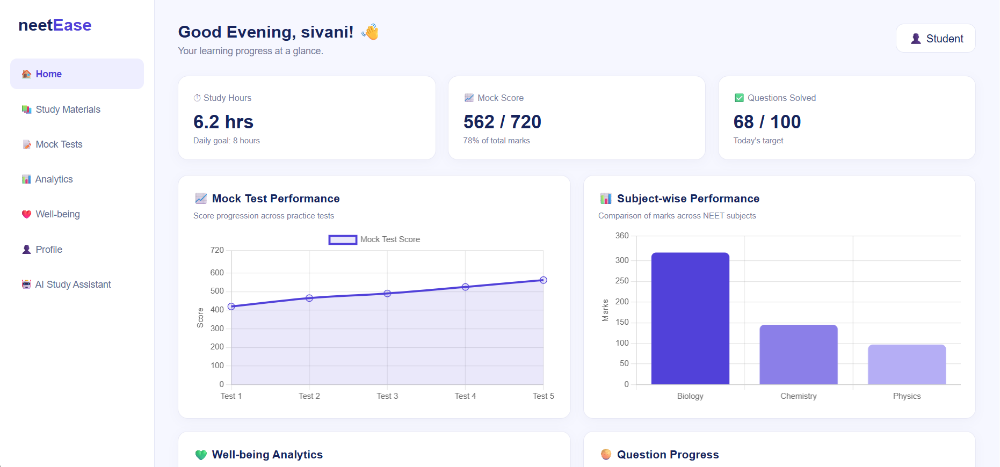
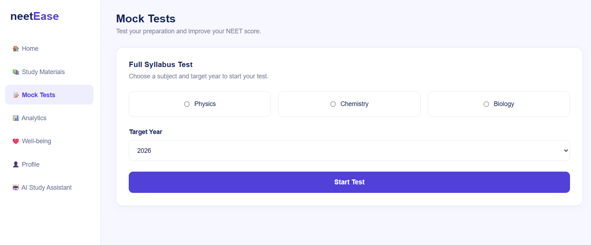
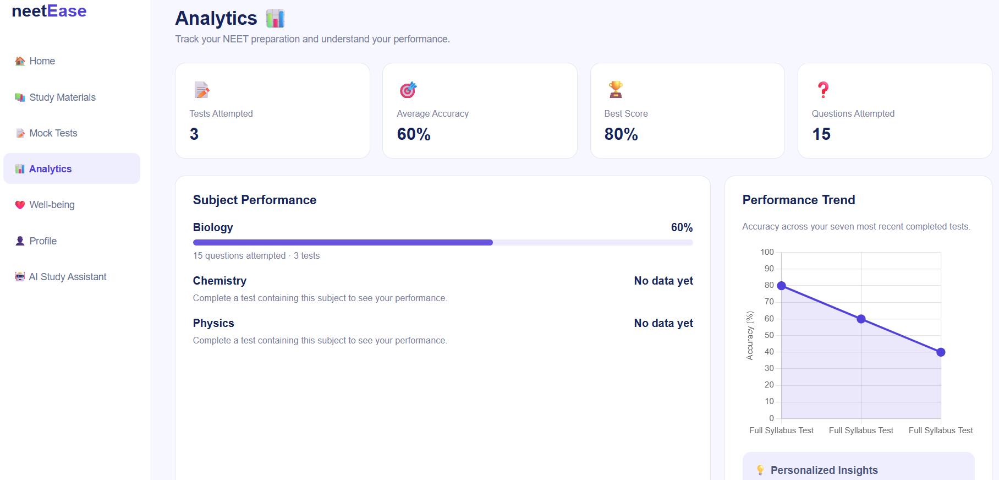
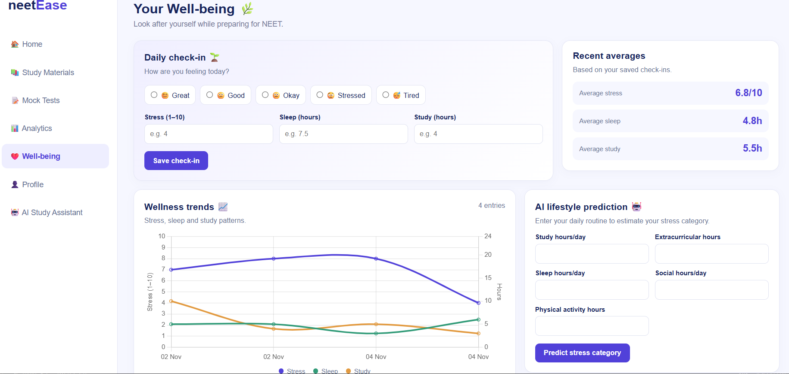

# neetEase

 AI-Powered NEET Preparation & Student Well-being Platform

An integrated educational platform that combines **Web Development, Data Science and Machine Learning** to support NEET aspirants through personalized learning, academic analytics and student well-being monitoring.

---

 ✨ Features

| Module                | Description                                           |
| --------------------- | ----------------------------------------------------- |
| Student Dashboard     | Centralized student activity overview                 |
| Study Materials       | Subject-wise Physics, Chemistry and Biology resources |
| Mock Tests            | Interactive tests with automated scoring              |
| Performance Analytics | Score tracking, accuracy analysis and visualizations  |
| Well-being Tracker    | Daily mood, stress, sleep and study-hour tracking     |
| Stress Prediction     | ML-based student stress-level prediction              |
| Personalized Insights | Data-driven student recommendations                   |
| Student Profile       | Account and profile management                        |

 🧠 Machine Learning

**Objective:** Predict student stress levels using lifestyle-related factors.

- **Algorithm:** Logistic Regression
- **Dataset:** Daily Lifestyle and Academic Performance of Students
- **Records:** 2,000
- **Input Features:** Study hours, extracurricular hours, sleep hours, social hours and physical activity hours
- **Target:** Stress_Level
- **Preprocessing:** SimpleImputer and StandardScaler
- **Model Storage:** Joblib

Model Performance

\<details> \<summary>\<b>Evaluation details\</b>\</summary>

| Metric         | Result |
| -------------- | -----: |
| Test Accuracy  | 84.25% |
| Training Split |    80% |
| Testing Split  |    20% |
| Random State   |     42 |

\</details>

🛠️ Technology Stack

| Area              | Technologies          |
| ----------------- | --------------------- |
| Backend           | Python, Django        |
| Frontend          | HTML, CSS, JavaScript |
| Database          | SQLite                |
| Data Analysis     | Pandas, NumPy         |
| Machine Learning  | Scikit-learn          |
| Visualization     | Chart.js, Matplotlib  |
| Model Persistence | Joblib                |

 📁 Project Structure

```text
neetEase/
├── config/             # Django configuration
├── core/
│   ├── migrations/     # Database migrations
│   ├── templates/      # HTML templates
│   ├── models.py       # Database models
│   ├── views.py        # Application views
│   └── admin.py
├── ml/
│   ├── artifacts/      # Trained model and evaluation
│   ├── train_model.py
│   └── test_prediction.py
├── manage.py
├── requirements.txt
└── .gitignore
```

🚀 Installation

**1. Clone the repository**

```bash
git clone https://github.com/neyhaa06/NEETease.git
cd NEETease
```

**2. Create and activate a virtual environment**

```bash
python -m venv .venv
.venv\Scripts\activate
```

**3. Install dependencies**

```bash
pip install -r requirements.txt
```

**4. Configure environment variables**

Create a `.env` file in the project root:

```env
SECRET_KEY=your-secret-key
DEBUG=True
ALLOWED_HOSTS=127.0.0.1,localhost
```

**5. Apply migrations**

```bash
python manage.py migrate
```

**6. Run the application**

```bash
python manage.py runserver
```

Open `http://127.0.0.1:8000/` in your browser.

🔮 Future Enhancements

- Advanced academic performance prediction
- Enhanced personalized study recommendations
- Expanded student analytics
- Improved AI-driven student support

 👩‍💻 Project

**neetEase** — A Data Science and Machine Learning integrated educational platform.

Developed by **Neha Fathima**.
📸 Screenshots

 Dashboard


Mock Tests


Performance Analytics


 Student Well-being
